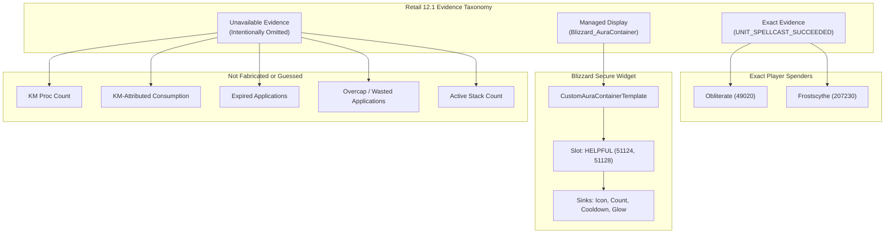

# Pull Request / Audit Report: KMProcsTracker — Retail 12.1 (Interface 120100) Compliance & Honest Evidence Model Refactor

## Executive Summary

| Item | Details |
| :--- | :--- |
| **Addon Name** | **KMProcsTracker** (Killing Machine Procs Tracker) |
| **Addon Directory** | `_Addons/KMProcsTracker` |
| **Remote Repository** | `github-km-procs-tracker` (`https://github.com/UnknownAlienHuman/km-procs-tracker.git`) |
| **Target Client** | World of Warcraft: Midnight / Retail 12.1 (`Interface: 120100`, Build `12.1.0.69497`) |
| **Addon Purpose** | Killing Machine tracking display and spender cast telemetry for Frost Death Knights. |
| **Audit Date** | 2026-09-08 |
| **Local Status** | **v0.3.46 (Severely Broken for 12.1)**: Relies on obsolete heuristic backends (`Backend_CooldownViewer.lua`, raw `UNIT_AURA` reads, `SPELL_ACTIVATION_OVERLAY_*` scraping, action-button glow inspection, `TestLab.lua`, and `DevTools/`). High risk of taint, secret-value arithmetic crashes, and `[ADDON_ACTION_FORBIDDEN]` in combat. |
| **Remote Status** | **v0.4.0 (Fully Modernized & Compliant)**: Complete architectural refactoring on `github-km-procs-tracker/main` (and branch `fix/retail-12-1-evidence-model-2026-08-29`). Purged 5,450 lines of fragile heuristics; implemented the **Honest Retail 12.1 Evidence Model** utilizing `Blizzard_AuraContainer` (`CustomAuraContainerTemplate`), exact player cast counters (`UNIT_SPELLCAST_SUCCEEDED`), and explicit `unavailable` taxonomy. |

---

## Remote Comparison (`git diff HEAD:_Addons/KMProcsTracker github-km-procs-tracker/main`)

A comparative analysis between the local workspace `HEAD:_Addons/KMProcsTracker` and remote `github-km-procs-tracker/main` reveals an extensive architectural shift:

```
 AGENT_GUIDE.md                     |  180 +-
 ARCHITECTURE.md                    |  106 +-
 Backend_CooldownViewer.lua         |  773 --------
 CODE_GRAPH.md                      |   27 +-
 CODE_INDEX.md                      |   25 +-
 Core.lua                           | 3406 ++++--------------------------------
 DevTools/DevTools.lua              |  192 --
 DevTools/DevToolsUI.lua            |  437 -----
 KMProcsTracker.toc                 |   13 +-
 Minimap.lua                        |  111 +-
 README.md                          |   94 +-
 README_DEV.txt                     |   87 -
 TODO.md                            |   64 -
 TestLab.lua                        |  337 ----
 UI.lua                             |  554 +++---
 tests/test_evidence_model_12_1.lua |  184 ++
 16 files changed, 1140 insertions(+), 5450 deletions(-)
```

### Upstream Commit Journey:
The upstream repository `github-km-procs-tracker` executed a systematic 14-commit architectural transformation:
1. `71a8909`: `chore: target Retail 12.1 and remove heuristic backends`
2. `a941bd4`: `refactor: remove cooldown-viewer state inference`
3. `d674c30`: `refactor: remove heuristic proc diagnostics`
4. `149cc14`: `refactor: remove heuristic proc diagnostics UI`
5. `f675138`: `refactor: remove obsolete secret-value probe lab`
6. `fc29cf3`: `test: cover the honest Retail 12.1 evidence model`
7. `6fbc213`: `docs: document the honest Retail 12.1 evidence model`
8. `d3b5865`: `docs: define exact, managed, and unavailable evidence classes`
9. `3f167ea`: `docs: rewrite agent instructions around honest evidence`
10. `8a917aa`: `docs: update the evidence-safe code index`
11. `cced743`: `docs: update the evidence-safe code graph`
12. `889303a`: `chore: carry the Retail 12.1 validation matrix in the implementation PR`
13. `342f539`: `docs: remove obsolete heuristic backend notes`
14. `e11c277`: `test: make the inaccessible proxy comparison-safe inside the harness`

### Key Assessment:
The upstream repository already completed the massive rewrite required for Retail 12.1. The local workspace directory, however, remains stranded on commit `6ba83d6` (v0.3.46). This PR reconciles the local codebase with upstream, bringing local code to full v0.4.0 Retail 12.1 compliance.

---

## Detailed Audit Findings against Retail 12.1 & KB Standards

### 1. TOC Interface Metadata & Dependencies (Critical)
- **Local State (`KMProcsTracker.toc:1-7`)**:
  ```toc
  ## Interface: 120000, 120001
  ## Title: KM Procs Tracker
  ## Version: 0.3.46
  ## SavedVariables: KMProcsTrackerDB
  ## OptionalDeps: LibStub, CallbackHandler-1.0, LibDataBroker-1.1, LibDBIcon-1.0
  ```
- **Violations**:
  - Outdated Interface version. Retail 12.1 requires `## Interface: 120100`.
  - Missing mandatory 12.1 system dependency: `## Dependencies: Blizzard_AuraContainer`.
  - Missing `## X-Verified-Build: 12.1.0.69497`.
  - Stale TOC file list loading deleted files (`Backend_CooldownViewer.lua`, `DevTools/*`, `TestLab.lua`).
- **Required 12.1 Configuration**:
  ```toc
  ## Interface: 120100
  ## Title: KM Procs Tracker
  ## Notes: Blizzard-managed Killing Machine display with exact spender-cast evidence for Retail 12.1.
  ## Author: Neomorph
  ## Version: 0.4.0
  ## SavedVariables: KMProcsTrackerDB
  ## Dependencies: Blizzard_AuraContainer
  ## OptionalDeps: LibStub, CallbackHandler-1.0, LibDataBroker-1.1, LibDBIcon-1.0
  ## X-Verified-Build: 12.1.0.69497
  ```

---

### 2. Critical SecretValue & Combat Lockout API Failure (`UNIT_AURA` / `C_UnitAuras`)
- **Local State (`Core.lua:2619`, `Core.lua:1500-1650`)**:
  - Registers `EventFrame:RegisterUnitEvent("UNIT_AURA", "player")`.
  - Executes `Addon:SyncStacksFromAura()` and `FindKillingMachineAura()`, querying `C_UnitAuras.GetPlayerAuraBySpellID` and iterating auras via `AuraUtil.ForEachAura`.
- **Defect in Retail 12.1**:
  - In Retail 12.1 (Midnight), player aura information is restricted during combat lockdown and protected contexts.
  - Many aura attributes (including applications/stacks and duration timestamps) return as `SecretValue` objects.
  - In local `Core.lua`, raw arithmetic (`newStacks - oldStacks`), string formatting, and nil/number comparisons on aura return values trigger fatal Lua errors:
    `attempt to perform arithmetic on a secret value` or `attempt to compare secret with number`.
  - Furthermore, aura payload inspection inside restricted execution contexts causes instant execution aborts and UI taint.
- **Retail 12.1 Solution**:
  - Completely abandon raw `UNIT_AURA` handling and `C_UnitAuras` inspection.
  - Transition to Blizzard's secure **`CustomAuraContainerTemplate`** (see Finding 3 below).

---

### 3. Elimination of Cooldown Viewer Scraping & Taint Hazards (`Backend_CooldownViewer.lua`)
- **Local State (`Backend_CooldownViewer.lua:1-773`)**:
  - Attempts to locate Blizzard's internal `BuffIconCooldownViewer`.
  - Crawls child widgets (`GetChildren()`, `GetNumChildren()`).
  - Reads stack counts directly from `childFrame.Applications.Applications:GetText()`.
  - Directly hooks `childFrame.Cooldown:SetCooldown()` to detect aura refresh at cap.
  - Runs a continuous background ticker (`C_Timer.NewTicker(0.50)`) scanning frame trees.
- **Defect in Retail 12.1**:
  - **Severe UI Taint**: Hooking methods on Blizzard's internal secure action/buff widgets or inspecting their secure fontstrings propagates taint into the secure execution path. During combat lockdown, any subsequent secure action (e.g. casting, changing targets, pet commands) triggers fatal `[ADDON_ACTION_FORBIDDEN]` errors.
  - **Frame Recycling**: Blizzard's Cooldown Viewer frames are pooled and recycled dynamically. Scraping textures and hooked scripts leads to stale references, memory leaks, and phantom proc tracking.
  - **Obsolete Secret Scrapes**: Cooldown objects in 12.1 utilize protected timestamps that cannot be read or compared.
- **Retail 12.1 Solution**:
  - Delete `Backend_CooldownViewer.lua` entirely.
  - Implement zero frame scraping, zero child frame iterations, and zero cooldown script hooks.

---

### 4. Elimination of Presentation-Layer Heuristics: Spell Activation Overlays & Action Button Glows
- **Local State (`Core.lua:2625-2628`, `Core.lua:3004-3086`)**:
  - Registers `SPELL_ACTIVATION_OVERLAY_GLOW_SHOW/HIDE` and `SPELL_ACTIVATION_OVERLAY_SHOW/HIDE`.
  - Attempts to deduce proc gain/loss from action button glows (`ActionButton_ShowOverlayGlow`).
  - Attempts to infer spender casts via timing-window matching (`SPEND_WINDOW = 1.40`, `OVERCAP_DEDUP = 0.10`).
- **Defect in Retail 12.1 (WOWUI-2026-012)**:
  - Presentation events are not state truth. Multiple action buttons across primary, secondary, and stance bars glow simultaneously for a single Killing Machine proc, creating duplicate signals.
  - Client latency, frame drop, and overlay animation delays result in race conditions where glows hide long after spenders are cast or fail to hide upon rapid spender chaining.
  - Hooking `ActionButton_ShowOverlayGlow` in 12.1 causes taint on secure action buttons.
- **Retail 12.1 Solution**:
  - Purge all overlay and action-button glow event registrations, hooks, and inference timers.

---

### 5. Decommissioning Combat Log (CLEU) Scraping & Test Labs
- **Local State (`Core.lua:3100-3139`, `TestLab.lua:1-337`, `DevTools/*`)**:
  - Contains full `COMBAT_LOG_EVENT_UNFILTERED` parsing routines, local attack-speed token buckets, Pillar of Frost proc budgets, and command `/kmpt cltest`.
  - `TestLab.lua` and `DevTools/` inject simulated events, hook core methods, and run secret-value probes.
- **Defect in Retail 12.1**:
  - `COMBAT_LOG_EVENT_UNFILTERED` is restricted and cannot be used by non-Blizzard addons for automated aura/proc telemetry in combat.
  - Retaining dead CLEU hooks and simulation harnesses bloats the addon by thousands of lines, confuses users with non-functional debug commands, and violates RT-AUDIT-002.
- **Retail 12.1 Solution**:
  - Delete `TestLab.lua`, `DevTools/DevTools.lua`, and `DevTools/DevToolsUI.lua`.
  - Remove all CLEU logic and debug commands from `Core.lua`.

---

### 6. RT-AUDIT-001: SavedVariables Default Mutation & Schema v4 Migration
- **Local State (`Core.lua:132-141`, `Core.lua:2632-2660`)**:
  ```lua
  local function ApplyDefaults(dst, src)
      for k, v in pairs(src) do
          if type(v) == "table" then
              if type(dst[k]) ~= "table" then dst[k] = {} end
              ApplyDefaults(dst[k], v)
          elseif dst[k] == nil then
              dst[k] = v
          end
      end
  end
  ```
  - `DEFAULT_DB` is populated with obsolete heuristic settings (`cdm`, `glow`, `hybridAuraTruth`, `useCreditFilter`, `actionSlotToSpell`, etc.).
  - Legacy counters (`procs`, `used`, `expired`, `wasted`, `overcap`) are persistent or dynamically merged.
- **Vulnerabilities**:
  - Nested tables without strict type checks risk reference aliasing.
  - Persisting approximate/guessed counters misrepresents historic telemetry as exact data.
- **Retail 12.1 Modernization**:
  - Implement `MergeDefaults` with recursive deep cloning:
    ```lua
    local function MergeDefaults(destination, source)
      destination = SafeTable(destination) or {}
      for key, value in pairs(source) do
        if type(value) == "table" then
          destination[key] = MergeDefaults(destination[key], value)
        elseif type(destination[key]) ~= type(value) then
          destination[key] = value
        end
      end
      return destination
    end
    ```
  - Introduce **Schema Version 4**:
    - Cleanly migrates user frame coordinates (`point`, `relativePoint`, `x`, `y`, `scale`, `shown`, `locked`) and minimap icon placement.
    - Explicitly discards stale approximate counters.
    - Sets `migration.retiredApproximateCounters = true`.
    - Sanitizes all entries via `SanitizeDB`, validating types and clamping numerical ranges.

---

### 7. RT-AUDIT-002: Single Runtime Owner Consolidation
- **Local Violation**:
  - Local code featured sprawling, competing execution owners across 5 files: `Core.lua`, `Backend_CooldownViewer.lua`, `DevTools/DevTools.lua`, `DevTools/DevToolsUI.lua`, and `TestLab.lua`.
  - Tickers, event hooks, and simulated state updates conflicted directly with the main UI loop.
- **Retail 12.1 Architecture**:
  - Strict separation of single runtime ownership:
    - **`Core.lua`**: Sole owner of SavedVariables, schema migration, slash commands, value access authorization, and exact spender event routing (`UNIT_SPELLCAST_SUCCEEDED`).
    - **`UI.lua`**: Sole owner of the visual frame, neutral placeholder backdrop, context menu, and Blizzard `CustomAuraContainerTemplate` configuration.
    - **`Minimap.lua`**: Sole owner of the LibDataBroker / LibDBIcon launcher.
  - Zero competing event frames, zero tickers, zero per-frame `OnUpdate` polling loops.

---

### 8. SecretValue Guards & Combat-Deferred Lifecycle
- **Access Boundary (`Core.lua:60-105`)**:
  - Before any value from an event payload, API call, or SavedVariables table is evaluated, it must pass strict access checks:
    ```lua
    local function CanAccess(value)
      if type(canaccessvalue) == "function" then
        local ok, accessible = pcall(canaccessvalue, value)
        return ok and accessible == true
      end
      if type(issecretvalue) == "function" then
        local ok, secret = pcall(issecretvalue, value)
        return ok and secret ~= true
      end
      return true
    end
    ```
  - Defensive type wrappers (`SafeBoolean`, `SafeNumber`, `SafeString`, `SafeTable`, `SafeText`) guarantee that inaccessible values are never converted to numbers, formatted, string-concatenated, compared, or persisted.
- **InCombatLockdown Protection (`UI.lua:60-120`)**:
  - Creating frames, attaching to `UIParent`, altering points, or modifying `CustomAuraContainer` slots during combat is strictly forbidden.
  - `UI:CreateManagedAura()` and `UI:ApplyDB()` detect `InCombatLockdown()`. If combat is active:
    - Sets `self.pendingInit = true` and `self.pendingApply = true`.
    - Defers all secure frame operations until `PLAYER_REGEN_ENABLED` triggers `UI:FlushPending()`.

---

### 9. The Honest Retail 12.1 Evidence Model
In Retail 12.1, accurate tracking requires strict categorization into three distinct evidence classes:



1. **Exact Evidence**:
   - Authorized, accessible `UNIT_SPELLCAST_SUCCEEDED` events for `player`.
   - Filters strictly for spender spell IDs: `49020` (Obliterate) and `207230` (Frostscythe).
   - Accurately tracks successful spender casts. Explicitly documented as *successful casts*, **not** assumed KM consumption.
2. **Managed Display**:
   - Configures one `CustomAuraContainerTemplate` container with `AddAuraSlot("killing_machine", "HELPFUL", options)`.
   - Binds candidate filter to Killing Machine aura IDs: `51124` and `51128`.
   - Registers presentation sinks (`SetIcon`, `SetApplicationCount`, `SetDurationCooldown`).
   - Addon code **never queries, stores, or branches on the resulting AuraButton**. Blizzard securely manages visibility, icon, stack counts, and cooldown swipes without leaking restricted aura data.
3. **Unavailable Evidence**:
   - Proc count, KM-attributed use, expiration, overcap/waste, and current stacks cannot be reliably proven in 12.1.
   - The addon intentionally displays explicit `unavailable` labels in tooltips and `/kmpt status`, refusing to fabricate guessed numbers.

---

### 10. Slash Command & Menu Modernization
- **Pruned Commands**:
  - Removed all dead commands: `/kmpt backend`, `/kmpt hybrid`, `/kmpt devtools`, `/kmpt secret`, `/kmpt lab`, `/kmpt cltest`, `/kmpt auradump`, `/kmpt cdm`, `/kmpt debug`.
- **Modernized Commands**:
  - `/kmpt`: Toggle frame visibility.
  - `/kmpt show` / `/kmpt hide`: Explicit frame visibility.
  - `/kmpt toggle`: Enable/disable tracking and managed display.
  - `/kmpt reset`: Reset exact spender cast counters.
  - `/kmpt lock` / `/kmpt unlock`: Toggle frame drag lock.
  - `/kmpt scale 0.60..3.00`: Adjust frame scale.
  - `/kmpt minimap show|hide`: Configure minimap launcher visibility.
  - `/kmpt status`: Print exact cast counts and explicit unavailable metric disclosure.
- **Modern Context Menu**:
  - Utilizes Retail `MenuUtil.CreateContextMenu` on right-click.

---

## File-by-File Breakdown of Proposed Changes

### 1. Files to Delete (6 Files, -1,890 Lines)
The following legacy heuristic and simulation files must be deleted from the addon directory:
- `Backend_CooldownViewer.lua` (773 lines)
- `DevTools/DevTools.lua` (192 lines)
- `DevTools/DevToolsUI.lua` (437 lines)
- `TestLab.lua` (337 lines)
- `README_DEV.txt` (87 lines)
- `TODO.md` (64 lines)

### 2. Files to Add (1 File, +184 Lines)
- `tests/test_evidence_model_12_1.lua`: Offline deterministic unit regression test validating schema migration, legacy counter retirement, combat deferral, managed display sinks, inaccessible SecretValue rejection, exact cast tracking, disable, and reset behavior.

### 3. Production Code Updates

#### A. `KMProcsTracker.toc`
- Update interface to `120100`.
- Bump version to `0.4.0`.
- Add `## Dependencies: Blizzard_AuraContainer`.
- Add `## X-Verified-Build: 12.1.0.69497`.
- Remove all deleted Lua files from the manifest.

#### B. `Core.lua` (Reduced from 3,139 to 307 Lines)
- Implement schema v4 migration with `retiredApproximateCounters = true`.
- Implement `MergeDefaults` (pure deep copy) and `SanitizeDB`.
- Implement `CanAccess`, `SafeBoolean`, `SafeNumber`, `SafeString`, `SafeTable`, `SafeText`.
- Single `EventFrame` registering only:
  - `ADDON_LOADED`
  - `PLAYER_LOGIN`
  - `PLAYER_REGEN_ENABLED`
  - `UNIT_SPELLCAST_SUCCEEDED` (unit: `player`)
- Exact cast tracking for Obliterate (`49020`) and Frostscythe (`207230`).
- Modernized `/kmpt` slash command handler.

#### C. `UI.lua` (Rewritten from 416 to 241 Lines)
- Implement `CustomAuraContainerTemplate` with `AddAuraSlot`.
- Candidate filter: `{ [51124] = true, [51128] = true }`.
- Initialize managed button with `SetIcon`, `SetApplicationCount`, `SetDurationCooldown`, and static border glow.
- Neutral backdrop placeholder (`SetDesaturated(true)`, `SetAlpha(0.20)`).
- Combat lockdown deferral (`pendingInit`, `pendingApply`, `FlushPending`).
- Tooltip and `MenuUtil` context menu displaying exact cast counts and explicit `unavailable` labels.

#### D. `Minimap.lua` (Refactored to 66 Lines)
- LDB data object with `GetIcon()`.
- Exact spender cast reporting in tooltip.
- Explicit notice: `"KM proc/use/expired/overcap counts: unavailable"`.
- Left-click toggle, right-click reset.

#### E. Documentation Updates
- `AGENT_GUIDE.md`: Updated with 12.1 product contract, hard prohibitions, and change routing.
- `ARCHITECTURE.md`: Documented three evidence classes, ownership boundaries, and schema v4.
- `CODE_GRAPH.md`: Modernized Mermaid diagram reflecting evidence-safe architecture.
- `CODE_INDEX.md`: Updated responsibility index.
- `README.md`: Modernized documentation with 12.1 compatibility, evidence model, and commands.

---

## Detailed PR Diffs

### `KMProcsTracker.toc`
```diff
--- a/_Addons/KMProcsTracker/KMProcsTracker.toc
+++ b/_Addons/KMProcsTracker/KMProcsTracker.toc
@@ -1,22 +1,19 @@
-## Interface: 120000, 120001
+## Interface: 120100
 ## Title: KM Procs Tracker
-## Notes: Tracks Killing Machine procs, consumption, and wasted (overcap) procs. Includes minimap button (LDB).
+## Notes: Blizzard-managed Killing Machine display with exact spender-cast evidence for Retail 12.1.
 ## Author: Neomorph
-## Version: 0.3.46
+## Version: 0.4.0
 ## SavedVariables: KMProcsTrackerDB
+## Dependencies: Blizzard_AuraContainer
 ## OptionalDeps: LibStub, CallbackHandler-1.0, LibDataBroker-1.1, LibDBIcon-1.0
+## X-Verified-Build: 12.1.0.69497
 
 libs/LibStub/LibStub.lua
 libs/CallbackHandler-1.0/CallbackHandler-1.0.lua
 libs/LibDataBroker-1.1/LibDataBroker-1.1.lua
 libs/LibDBIcon-1.0/lib.xml
 
 Core.lua
-Backend_CooldownViewer.lua
 UI.lua
 Minimap.lua
-DevTools/DevTools.lua
-DevTools/DevToolsUI.lua
-TestLab.lua
```

---

## Verification & Live Validation Matrix

### 1. Offline Regression Harness (`tests/test_evidence_model_12_1.lua`)
The included test harness executes deterministic checks simulating the Retail 12.1 engine:
- Verifies DB Schema v4 migration cleanly discards legacy approximate counters (`procs`, `used`, `expired`, `overcap`) and sets `migration.retiredApproximateCounters = true`.
- Verifies that when `InCombatLockdown()` is true during `PLAYER_LOGIN`, `CustomAuraContainer` creation is deferred (`pendingInit = true`), and completes cleanly upon `PLAYER_REGEN_ENABLED`.
- Verifies that `UNIT_AURA` and `COMBAT_LOG_EVENT_UNFILTERED` are **not** registered.
- Verifies that `UNIT_SPELLCAST_SUCCEEDED` only counts successful casts for `player`, and ignores other units (`target`) and non-spender spell IDs.
- Verifies that when a `SecretValue` proxy is passed as a spell ID, the access boundary catches it safely without triggering comparison/arithmetic exceptions.
- Verifies that disabling the addon ceases counting and hides/disables the managed container.
- Verifies that `ResetCounters` zeroes exact counters.

### 2. Live Client Validation Matrix

| Category | Test Case | Expected Behavior |
| :--- | :--- | :--- |
| **Lifecycle** | Clean Login & Addon Loading | `KMProcsTrackerDB` initializes cleanly; frame appears at default or saved position; no Lua errors. |
| **Migration** | Upgrade from v0.3.x DB | Frame position and minimap settings preserved; legacy approximate counters discarded; `migration.retiredApproximateCounters` set. |
| **Aura Display** | Out-of-Combat KM Proc | Blizzard `CustomAuraContainer` displays KM icon, stack count, and duration cooldown; background neutral placeholder remains static. |
| **Combat Safety** | Proc during Combat Lockdown | Managed AuraContainer updates securely via Blizzard engine; zero Lua errors; zero taint or `[ADDON_ACTION_FORBIDDEN]`. |
| **Combat Deferral**| Reload/Login while InCombatLockdown | AuraContainer creation and layout defer until `PLAYER_REGEN_ENABLED`; no combat lock violations. |
| **Exact Counters** | Cast Obliterate / Frostscythe | Spender cast count increments accurately on frame and tooltip; non-spender casts ignored. |
| **Secret Values** | Restricted Combat Environment | Event arguments with SecretValues rejected safely by `CanAccess` boundary without crashes. |
| **UI Interaction** | Dragging & Context Menu | Unlocked frame drags smoothly; position persists across reloads; right-click opens modern `MenuUtil` context menu. |
| **Minimap Icon** | LDB / LibDBIcon Launcher | Minimap icon displays KM texture; tooltip displays exact casts and explicit unavailable taxonomy; left-click toggles frame; right-click resets counters. |
| **Slash Commands** | `/kmpt [command]` | All modernized subcommands (`show`, `hide`, `toggle`, `reset`, `lock`, `unlock`, `scale`, `status`) execute cleanly. |

---

## Conclusion & Recommendation

The local workspace copy of `KMProcsTracker` at `C:\Development\WoWDevAddons\_Addons\KMProcsTracker` is completely superseded by the modernized implementation on `github-km-procs-tracker/main`. The legacy 0.3.46 codebase relied on dangerous frame scraping, prohibited combat aura inspection, and presentation heuristics that are completely non-viable in Retail 12.1.

**Action Required**:
1. Synchronize the local directory `_Addons/KMProcsTracker` with remote `github-km-procs-tracker/main`.
2. Delete the 6 obsolete legacy files (`Backend_CooldownViewer.lua`, `DevTools/*`, `TestLab.lua`, `README_DEV.txt`, `TODO.md`).
3. Apply the modernized `KMProcsTracker.toc`, `Core.lua`, `UI.lua`, `Minimap.lua`, documentation, and `tests/test_evidence_model_12_1.lua`.
4. Run live client validation on Retail Build 12.1.0.69497.
